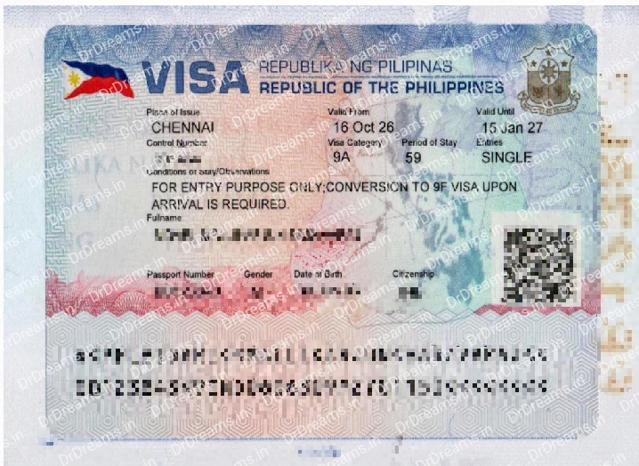
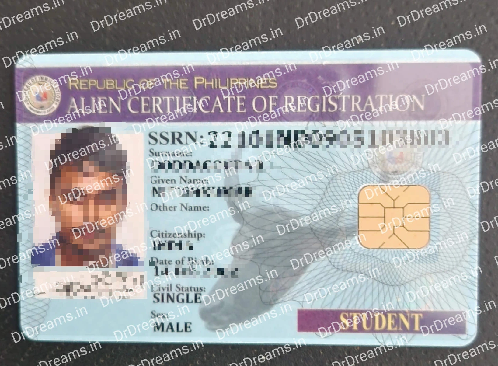
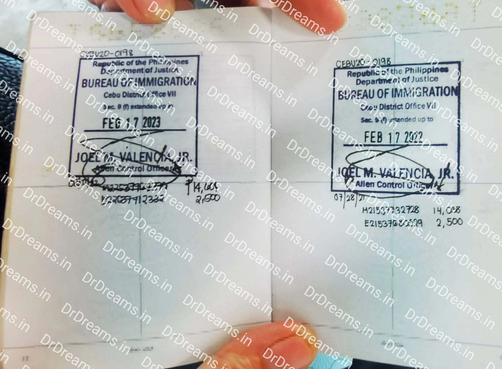

# 9F visa conversion and extension

Convert the entry 9A to a student 9F before it expires, then renew every year. The official charge is ₱14,500 for conversion and ₱16,000 for extension.

**Quick summary.**

The 9A sticker issued in India is valid for two to three months and is for entry only. Convert it to a student 9F inside that window, then renew the 9F every year while you study. The Bureau of Immigration charges ₱14,500 for conversion and ₱16,000 for extension; agencies quote ₱20,000 to ₱30,000 for the same file. You also need an ACR I-Card, a medical exam and NBI clearance, each with its own fee. Apply before the 9A expires, or you are filing for something else rather than converting anything.

*Steps and requirements from the guide by Dr. Nitz. Checked 27 November 2026. Confirm current fees with the Bureau of Immigration before paying.*

## The 9A sticker is not a student visa

The 9A issued in India is valid for two to three months. The sticker itself says entry purpose only and requires conversion to 9F on arrival. Convert inside that window. If the 9A expires first, you are applying for something else, not converting anything.

*9A entry visa. The condition is printed on the sticker.*

**Official charges**

Typical total, whole programme
:   ₱14,500 conversion, ₱16,000 yearly extension

ACR I-Card
:   ₱2,500 to ₱4,500 plus card fee

Medical exam
:   ₱1,500 to ₱4,000 depending on clinic

NBI clearance
:   ₱150 to ₱200

Agency quote
:   ₱20,000 to ₱30,000 for the same file

## Two fee lists, both worth knowing

The Bureau of Immigration publishes its own amounts on the [official Student Visa (9F) page](https://immigration.gov.ph/student-visa-9f/). That table is dated 06 March 2014 and the page says fees may change without prior notice. The figures above are from a 2026-27 guide to what students actually pay in Cebu, Manila and Davao. Both are here so you can compare them before you reach the counter.

Amounts posted by the Bureau of Immigration, dated 06 March 2014. Not a 2026-27 quote.

| Item | Conversion | Extension |
| --- | --- | --- |
| Application fee | ₱2,000 | — |
| Implementation fee | ₱1,000 | — |
| Service fee | ₱1,000 | — |
| Extension fee | — | ₱2,000 |
| Certificate fee | ₱500 | ₱500 |
| Visa fee | ₱1,000 | — |
| ICR, CRTV, CRTS, CRTT, CRPE | ₱1,400 | — |
| Legal research fee | ₱70 | ₱20 |
| Alien Certificate of Registration | ₱1,000 | — |
| Head tax | ₱250 | — |
| Express fee, certification | ₱500 | ₱500 |
| Express fee, filing | ₱500 | ₱500 |
| Express fee, I-card processing | ₱500 | ₱500 |
| **Total posted** | **₱9,720** | **₱4,020** |
| Additional ACR I-Card fee | $50 | $50 |

## 9A to 9F: the documents

- Passport
- Notice of Acceptance and Letter of Endorsement issued by the school registrar
- Bureau of Quarantine certificate and stamp
- NBI clearance
- Certificate of Eligibility for Admission from CHED, in case of medicine
- NMAT score above the 40th percentile
- Student visa with processing fee: ₱14,500

### The steps, in order

1. **Process NBI clearance.** Standard fee is ₱150 to ₱200. Do this first; everything else asks for it.
2. **Get the medical tests.** CBC, urinalysis, VDRL, chest X-ray and stool. A clinic charges ₱1,500 to ₱4,000 depending on where you go.
3. **Take the results to the Bureau of Quarantine.** They issue the medical certificate and stamp. The office location varies between Manila, Cebu and Davao.
4. **Ask the college for the Notice of Acceptance and Endorsement Letter.** The registrar issues it. Ask early; the letter is what the immigration office wants to see.
5. **Settle the student visa payment at the college Business Office.** Pay there and keep the receipt. Other college requests are settled at the same counter.
6. **Present the compiled requirements at the Bureau of Immigration.** Go to the office for your locality for payment and endorsement.
7. **Submit the endorsed set to the Student Desk.** Visa Section, Bureau of Immigration, Quezon City, for approval and implementation.

## Yearly 9F extension

File two months before the student visa expires. Missing that window is how people end up overstaying.

### What the college needs from you

- Passport
- CHED endorsement only if you are shifting course or transferring school. Otherwise the college submits on your behalf.
- Certificate of Grades for the two previous semesters
- Certificate of Eligibility for Admission from CHED, in case of medicine
- Student visa extension with processing fee: ₱16,000

### The steps, in order

1. **Request the certification of grades.** Ask the Registrar at your college for the last two semesters.
2. **Pay the visa fee at the college office.** Settle the student visa fee and any other requests there, and take the receipt.
3. **Present everything at the Bureau of Immigration.** Use the office in your college's region for payment and endorsement.
4. **Submit the endorsed set to the Student Desk.** Visa Section, Bureau of Immigration, for approval and implementation.

## The BI sequence, as published

The Bureau of Immigration lists these steps for conversion and renewal. The guide above adds the visits that happen before you reach them: NBI clearance, the lab tests, the Bureau of Quarantine stamp and the registrar's letter.

### Conversion to 9F

1. **Get the CGAF.** At the Public Information and Assistance Unit on the ground floor of the BI Main Office, or from the BI website.
2. **Submit for pre-screening.** Take the documents to the Central Receiving Unit or the frontline officer at an Immigration Office that handles this transaction.
3. **Pay the fees, then submit a copy of the official receipt.**
4. **Image and fingerprint capturing.** Proceed to the Alien Registration Division counter and submit the ACR I-Card requirements.
5. **Check the website for approval.**
6. **Submit the passport for implementation** once the visa is approved.
7. **Claim the ACR I-Card** once the card is approved.

### Extension of 9F

1. **Get the CGAF** from the BI Main Office or the BI website.
2. **Submit for pre-screening and pay the fees**, then submit the official receipt copy.
3. **Attend the hearing**, part of the extension application.
4. **Biometrics.** Previously captured data is reused for the renewed card. Applicants aged 10 and below are captured at every extension; those aged 11 and above every five years.
5. **Check approval, submit the passport, claim the card.** The same final three steps as conversion.

*Source: [Bureau of Immigration, Student Visa (9F)](https://immigration.gov.ph/student-visa-9f/).*

## The ACR I-Card and the extension stamp

After the 9F is approved you get the Alien Certificate of Registration I-Card. Budget ₱2,500 to ₱4,500 plus the card fee. Carry it. It is the proof that your registration is current, and the student label on the card is the one you will be asked for.

*ACR I-Card, front. The STUDENT label matters.*

*The BI extension stamp in the passport. The date printed on it is the one that matters.*

**You do not need an agency for this.**

The registrar gives you the acceptance and endorsement letter. The lab gives you the results. The Bureau of Quarantine stamps them. The Bureau of Immigration takes the payment and the endorsed file. That is the whole process.

Agencies quote ₱20,000 to ₱30,000 for work whose official charge is ₱14,500 to ₱16,000. You are paying for someone else's queue. Go yourself, pay at the counter, and keep every receipt.

The [admission process page](../admission-process/) covers the 9(F) issued in India before you fly. This page covers the conversion after arrival and the yearly renewal.

## Download the BI forms

These are the forms linked from the Bureau of Immigration's 9F page, hosted here so you can download them directly. They are marked by the BI as reproducible and not for sale.

- [Documentary requirements for conversion to 9F (V-NI-005, PDF)](forms/bi-9f-conversion-checklist.pdf)
- [General application form for conversion (CGAF-003 Rev 2, PDF)](forms/bi-9f-conversion-application-form.pdf)
- [Documentary requirements for extension of 9F (V-NI-006, PDF)](forms/bi-9f-extension-checklist.pdf)
- [General application form for extension (CGAF-003 Rev 2, PDF)](forms/bi-9f-extension-application-form.pdf)
- [Additional information on applicant's children (PDF)](forms/bi-applicant-children-information.pdf)

*Originals: [Bureau of Immigration, Student Visa (9F)](https://immigration.gov.ph/student-visa-9f/).*

## Original guide

The steps and requirements above come from the [9F conversion and extension guide by Dr. Nitz](9f-visa-conversion-and-extension-by-dr-nitz.pdf).

*Text licensed CC BY 4.0. Credit drdreams.in.*
