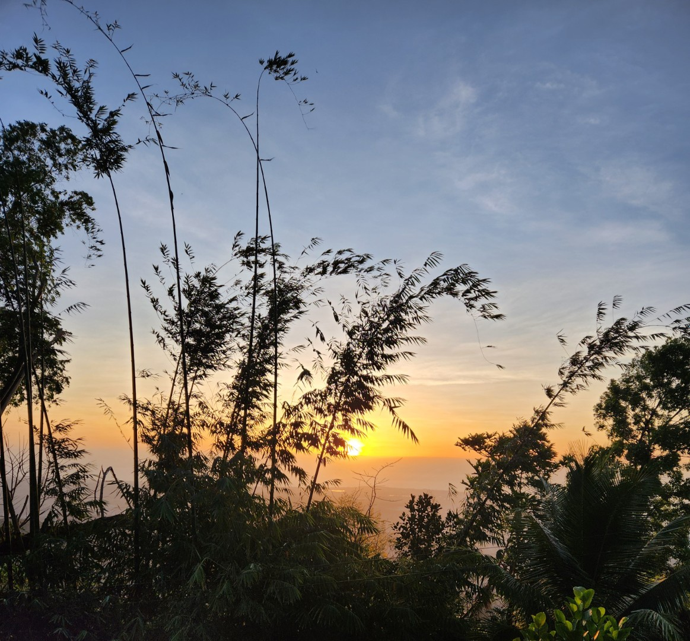
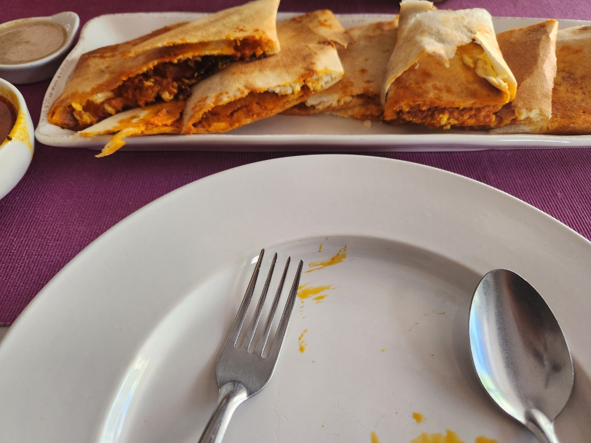
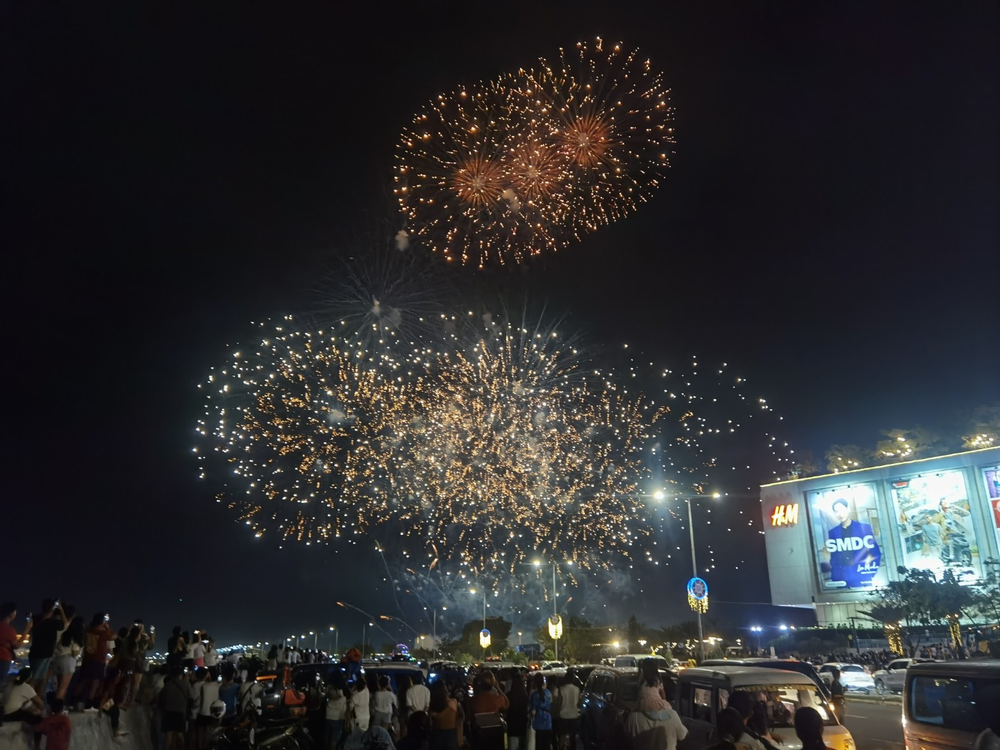
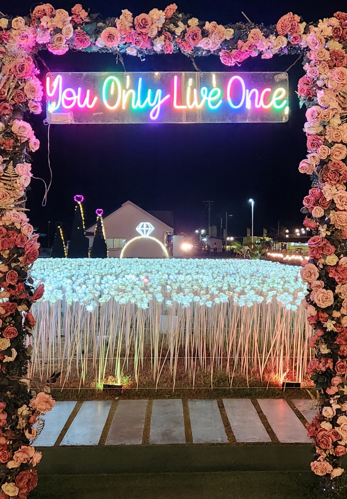

*About*

# Written by Dr. Nitz

Nitish writes under the name Dr. Nitz. The Doctor of Medicine is from Southwestern University, Cebu, 2025. DrDreams is a reference site for Indian students working through recognition, fees, documents, admission and the exams at the end. The point is to put the checks behind a 28 to 35 lakh decision in one place, with the source attached.

*By Dr. Nitz. Last updated 26 November 2026.*

## The short version

DrDreams is a set of reference pages about studying medicine in the Philippines, written for Indian students and their parents. It covers recognition, cost, the documents, admission, the exams afterwards, and what the years in between actually feel like.

The information that decides a 28 to 35 lakh spend over five and a half to six years sits in regulator PDFs, college fee sheets written for a different audience, and group chats where half the answers are wrong. This site puts it in one place, in plain English, with the source for anything that can be checked. The full course fee is never paid upfront to an agency; MD tuition goes to the college at official rates.

Some pages come from five and a half years in Cebu. Others use reports from graduates and students who studied at other colleges. Each page marks which, in a line near the top, so you can weigh it.

## The facts

Author
:   Dr. Nitz (Nitish)

Degree
:   Doctor of Medicine, Southwestern University, Cebu

Graduated
:   2025

FMGE
:   Cleared on the first attempt

Time in the country
:   Five and a half years in Cebu

Colleges covered
:   Six, all NMC-listed at the time of writing

Every page
:   Carries the date it was last reviewed

*The author*

## One graduate, five and a half years

Cebu, June 2019: two suitcases, a document folder checked four times, hostel food, a fan that clicked all night, and about two thirds of every lecture understood. By second year the city was ordinary rather than strange. The damp heat, the accent and the rice-heavy food are part of the degree, not side notes.

The MD came in 2025, with FMGE cleared on the first attempt. Back home, the same question arrives from every batch: where do I start? Most of these pages are the answer that question needed as a PDF.

No claim to be a professor, a cardiologist or an admissions officer. One graduate who kept every fee receipt, read the NMC gazette properly, and remembers what the paperwork felt like at nineteen. Where a page goes beyond that, it says so and links the source.

### On record

|  |  |
| --- | --- |
| Name | Nitish, writing as Dr. Nitz |
| Degree | Doctor of Medicine (MD) |
| College | Southwestern University, Cebu City |
| Graduated | 2025 |
| FMGE | Cleared, first attempt |
| Years in Cebu | Five and a half |

*The degree certificate can be sent on request. [Ask here](#contact).*

*Method*

## How a page gets made

1. ### Start with the primary source

   Recognition comes from the [NMC](https://www.nmc.org.in) list and [WDOMS](https://search.wdoms.org), checked against the 54 months of coursework and 12 months of CRMI in the same institution, taught in English. Fees come from the college's own fee sheet for the intake. Exam rules come from NMC and NBEMS notices, not a coaching centre's summary. If a claim cannot be traced to one of those, it does not go on the page as fact.
2. ### Say what is wrong with it

   Every college page carries cons in the same type as the pros: the size of the Indian batch, the hospital, the hostel, the city, the things graduates complain about when the brochure is closed. A page with no cons is an advertisement, and there are enough of those already.
3. ### Mark what is experience and what is not

   Some pages come from five and a half years in Cebu. Others come from graduates and students who studied at other colleges. Each one says which, in a line near the top, so you can weigh it. Second-hand detail is useful. Pretending it is first-hand is not.
4. ### Date it, then leave the door open

   Rules and fees move. Every page carries the month it was last reviewed, and the review date changes when the content does. Corrections are welcome from anyone, including a college that thinks its page is unfair, and they are checked against the source rather than against who asked loudest.

**What these pages do not claim.**

- That a seat, a visa, an internship or a licence is guaranteed. None of them are.
- That a college is good because it is on the NMC list. The list means recognition, not quality.
- That a fee quoted here will still be the fee when you pay. Fee sheets change every intake, which is why the pages tell you what to ask for.
- That this is medical, legal or immigration advice. It is information from one graduate, and the regulator and the college are the authority.
- Any connection to NMC, NBEMS, CHED, the Philippine government or any college named here.

When a page is wrong, it gets corrected and the correction is dated. That is the whole editorial policy, and the [contact page](#contact) is how it starts.

*Why the site exists*

## The account that started it

Everything above is policy. This is the one personal account on the site, kept because the first year generates more questions than any other.

> "NEET got me a qualification and not a government seat. I applied to Southwestern University in Cebu myself: emailed the admissions office, sent my own documents, and hired a consultant for the embassy paperwork alone. That saved money my family did not have to spare."
>
> "The first year was hard in ways nobody had warned me about. The food, the accent, learning to cook badly. By second year Cebu was a place I lived in rather than a place I was stuck in."
>
> "FMGE I started in second year and did it badly, then got serious in final year. Six to eight hours a day, past papers, a small group I studied with. First attempt."

Dr. Nitz, MD, Southwestern University, Cebu, 2025.

The first year generates more questions than any other, and it is the part no brochure describes. So the site has a page for it, written from the inside rather than from a campus tour. [Life in the Philippines](../student-life/) is the honest version, including the parts that were bad.

**Studied in the Philippines?**

If you have and want your account on this site, send it. Say whether it can carry your first name, your college and your year. Nothing is edited into praise: the complaints are the useful part.

*Student life*

## Cebu, on ordinary days

Not a campus brochure. This is what the weekends look like between exam blocks, and it is the same city on a Tuesday. If you are deciding whether to spend five years somewhere, that is the thing worth seeing.

Sunset through bamboo, Cebu mountains

Cebu beaches, an hour from the city

The bridge at night

Dosa in Cebu, a genuine event

New Year in Cebu

Weekend rides, stress therapy

Night market, Cebu

Cebu nightlife, in moderation

## Start with the guide

*The main page covers the whole route in one sitting: recognition, cost, the entrance problem, and the exams at the end. Everything else on the site hangs off it.*

[Read the full guide](../mbbs-in-philippines/)
[Correct a page](#contact)

## Send a message

Your name

WhatsApp number

Include the country code.

What is this about?

Correction to a page
A source or document to add
A question the pages do not answer
A broken link or typo
A student account to add
Privacy or data
Something else

Your message

Specifics help. Do not send original documents, payment details or your passport number.

Send on WhatsApp

*This form stores nothing on a server. It opens WhatsApp with your message already written. Email is better for anything long or anything you want in writing.*

## Or go direct

### WhatsApp

+63 995 916 4545. Fine for a short question or a correction. Replies usually come in the evening, Philippine time.

[Message](https://wa.me/639959164545?text=Hi%2C%20I%20read%20drdreams.in%20and%20have%20a%20correction%20or%20a%20question.)

### Telegram

@Niti0014. Useful if WhatsApp is blocked, or if you want to send a screenshot of a fee sheet.

[Message](https://t.me/Niti0014)

### Email

contact@drnitz.com. Best for corrections, sources and anything you want in writing.

[Write](mailto:contact@drnitz.com)

**What happens next.**

A correction is checked against the primary source, and if it holds, the page is fixed and its review date changes. A question that keeps arriving usually becomes a section on the page it belongs to, so the next person does not have to ask.

Nobody will call you, and your number is not passed to a college, a recruiter or anyone else.

*The boundary*

## What this is not

### What you get here

- Pages you can read without paying anything
- A source for the claims that matter
- A correction when something is wrong
- An answer to a question the pages do not cover

### What you will not get

- Anyone to file your application for you
- Documents held, checked or forwarded on your behalf
- Money moved, a seat reserved or a visa guaranteed
- Anything at all for sale

If you want someone to handle the filing, hire a licensed visa consultant and ask for their registration number first. That is a real service with a real price, and it is not this site. What this site can do is make sure you know which documents to gather, what the visa actually requires, and what a college should be putting in writing before you pay it.

[The document checklist](../admission-process/#documents) is the page to read before you sign anything.

## Read this before you write

*Most questions that arrive are answered already, usually on the guide or the costs page. It is faster than waiting for a reply, and it is the version with the sources attached.*

[Read the full guide](../mbbs-in-philippines/)
[See the costs](../fees-and-cost/)
