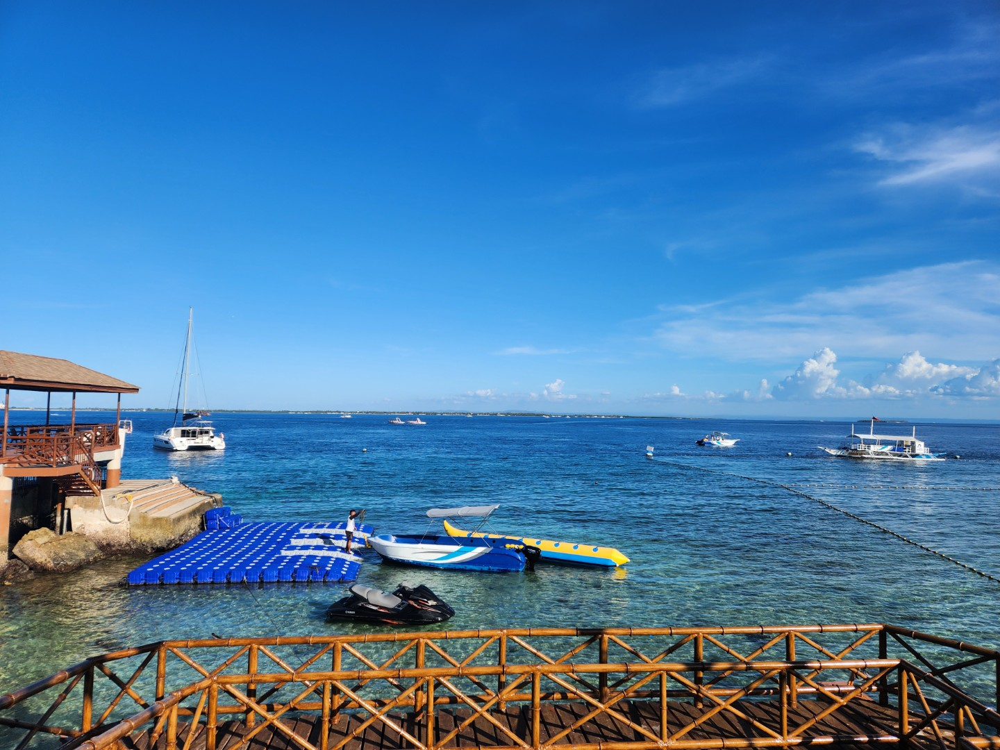

*2027 intake*

# Study MBBS in the Philippines

A complete guide for Indian students planning medicine in the Philippines, from choosing the college to landing in Cebu, Manila or Davao. What the five and a half years cost, which colleges are on India's NMC list, the BSBio question, the paperwork, and what the years actually look like.

[Compare the six colleges](colleges.html)
[What you need before you go](#before-you-go)

Every page carries the date it was last checked. The record behind the advice, and how to correct a page, is on [the about page](about.html).

## The basics

Degree
:   Doctor of Medicine (MD)

Duration
:   5.5 years, including the internship

Language
:   English throughout

Typical total, all in
:   Rs 35 to 45 lakh

College fees alone
:   Rs 21 to 30 lakh

Recognition
:   NMC list and WDOMS, check both

Colleges covered here
:   6 in Cebu, Manila, Davao

**November 2026: the Philippine licence is now open.**

Indian graduates of recognised Philippine medical schools can now sit the Physician Licensure Examination and register to practise in the Philippines, after the Philippine Professional Regulation Commission cleared the reciprocity rule. The Embassy of India, Manila confirmed it. It does not replace FMGE or NExT for practising in India. [What changed, and what it does not](ple-philippines.html).

*Start here*

## What you need before you go

Most students begin with a college name someone mentioned. These five questions are the order that works: recognition, the pre-medical year, the length, the money, then the life.

1. ### Which college, and is it on India's NMC list?

   Begin with the [NMC list of recognised foreign medical institutions](https://www.nmc.org.in) and the same college on [WDOMS](https://search.wdoms.org). A college missing from either list is a problem you cannot undo after five years. The [six colleges covered here](colleges.html) are checked against both, and you should check them yourself as well.
2. ### Do you need the BSBio year?

   BSBio is the pre-medical year Filipino students take before the MD, and Indian students without a bachelor's degree take it too. It runs one academic year at most colleges, it has to be CHED-recognised, and it does not replace NEET: NMC still expects NEET cleared before the MD begins. Some Indian institutes now sell shorter versions, so ask the college in writing whether it will accept the one you are being sold. [How the BSBio route works](admission-process.html#without-neet).
3. ### How long does the whole thing take?

   The MD is four years, and the fourth year is a full clinical clerkship. A twelve-month internship follows, so the medical part is five years, and the BSBio adds one more if you need it. NMC asks for 54 months of study excluding the internship, and CHED's letter to the Indian Embassy says the Philippine MD meets its conditions. Reconcile those two sentences in writing before you pay: ask the college for the curriculum with the month count, and for the line that says where the internship sits. [The 54-month rule and the notice behind it](mci-rules.html#fmgl-2021).
4. ### What does it cost, start to finish?

   College fees for the whole programme run from Rs 21 lakh to Rs 30 lakh on the 2026-2027 sheets. Add hostel, food, flights and visa renewals and the realistic total is Rs 35 lakh to Rs 45 lakh at most of the six, and closer to Rs 50 lakh at DMSF. Tuition is the number everyone quotes, and it is not the number that empties the account. [The lines, one by one](fees-and-cost.html).
5. ### What is actually good about it?

   The people, the weather, and English in the classroom and on the ward. Add the food, the names, and a language written in the Latin alphabet, which matters more than it sounds if you have also looked at Russia or China. [Life in the Philippines](student-life.html), and [life outside the classroom](life-outside-studies.html).

*Colleges*

## Six colleges, with the cons included

I do not list every college in the country. These are the six where I studied, visited, or have close friends who graduated. Each one carries the pros, the cons I would tell a cousin, and the official contact details.

**Why six.** NMC's Foreign Medical Graduate Licentiate Regulations, notified on 18 November 2021, set the conditions: 54 months of study, a twelve-month internship at the same university, English medium teaching, and a WDOMS listing. These are the six I could check against those conditions and against the embassy's reading of them. [The gazette, the 2026 notice and the official PDF](mci-rules.html).

[### GCM Gullas

Cebu City

★★★★★

The lowest entry cost among the six, with FMGE coaching on campus. Hostel is basic and the Indian batch is large.

Best valueFMGE coaching

Read the full review](colleges.html#gcm-gullas)
[### Southwestern University

Cebu City

★★★★☆

Where I studied. Strong hospital rotations and a smaller Indian batch. No in-house FMGE coaching, so plan for that.

Where I studiedClinical heavy

Read the full review](colleges.html#southwestern)
[### University of Perpetual Help

Las Piñas, Metro Manila

★★★★☆

The largest Indian community of the six, and the easiest place to find Indian food. Manila traffic is the price.

FMGE coachingBig Indian batch

Read the full review](colleges.html#perpetual)
[### DMSF

Davao City

★★★★☆

The 3D anatomy lab and heavy patient flow are real. Fees run higher than Cebu, and Davao is a longer flight home.

FMGE coachingAnatomage lab

Read the full review](colleges.html#dmsf)
[### Brokenshire College

Davao City

★★★☆☆

Smaller batches, so faculty know your name. The attached hospital is smaller than DMSF's, which matters in clinical years.

Small batchCadaver lab

Read the full review](colleges.html#brokenshire)
[### Jose Maria College

Sasa, Davao City

★★★☆☆

The tightest budget of the six, with medical missions you will not get elsewhere. You will be cooking your own food.

Lowest budgetMedical missions

Read the full review](colleges.html#jmc)

*The doubts*

## What students and parents ask first

Five questions come up more than any others. Short answers here, and the linked page if you want the long one.

**Is the degree valid in India?**

Yes, with three conditions: the college was on the NMC list when you joined and when you graduated, you clear FMGE or NExT, and you complete a twelve-month internship in India before you register. The exam is the part people underestimate. In 2025, 884 of 4,655 Philippine-trained candidates passed in June and 903 of 4,864 passed in December, about 19 per cent in each session, according to the [NBEMS FMGE performance report](https://natboard.edu.in). Start preparing in first year, not after the internship. [What the rules require](mci-rules.html#validity).

**Is the Philippines safe?**

I lived in Cebu for five and a half years and never felt unsafe walking home. That is one person's experience in one city, and it is worth more than a country index and less than a visit of your own. The [Philippine National Police](https://pnp.gov.ph) publish crime statistics, and [Numbeo](https://www.numbeo.com/crime/rankings_by_country.jsp) runs a perception survey that news stories quote; treat the second as opinion with decimals. Your city matters more than your country, and the hour matters more than the city. [Cebu, Manila and Davao compared](student-life.html#cities).

**Do I need to learn Tagalog or Cebuano?**

No. Lectures, hospital notes and paperwork are in English, and you can finish the degree without a word of either. Learning some Cebuano changes your day: the tricycle driver, the landlord, the patient who relaxes when you try. Both languages use the Latin alphabet, so reading signs is a matter of a dictionary, not a new script. [Language and daily life](student-life.html).

**Will I find Indian food?**

Yes, in all three cities. North Indian and South Indian restaurants, spice shops, and a few kitchens that will cook to order for a monthly rate. It costs more than cooking at home, and it is the line families forget when they compare hostels. The local food is worth your time as well: adobo, a chicken curry with less masala than your mother's, and Goto, a rice porridge eaten for breakfast. [Food, weekends and festivals](life-outside-studies.html).

**What can I do after the MD?**

Two routes. For India, clear FMGE or NExT, complete the twelve-month internship, then register with a state medical council; the paperwork differs by state, so ask the council where you plan to work. For the Philippines, the [Physician Licensure Examination](ple-philippines.html) is now open to Indian graduates, and a licence there means general practice or specialisation in the country. [FMGE, NExT and the timeline after the degree](fmge-next.html#after).

*Documents*

## The paperwork, before and after

Two sets of paper decide this. The first you gather in India before you fly. The second you collect in the Philippines before you come home, and it is the one people leave until the last week.

### Before you go

Passport with at least eighteen months of validity, class 10 and 12 marksheets, NEET scorecard and admit card, birth certificate, police clearance through the Passport Seva Portal, a medical certificate from a NABH-accredited hospital, and a six-month bank statement with a closing balance of Rs 3,00,000. Each item has a format and an authentication step. [The full checklist](admission-process.html#documents).

### Before you come home

Degree certificate, full transcript, internship completion certificate, English medium certificate, and the apostille and Indian embassy authentication on the documents you will submit in India. Keep the passport with every visa stamp, and keep scans of all of it in two places. [The list to keep for the rest of your career](mci-rules.html#keep).

### If you are going somewhere other than India

The same degree documents go through different bodies: [ECFMG](https://www.ecfmg.org) for the USMLE in the United States, [AMC](https://www.amc.org.au) for Australia, the [GMC](https://www.gmc-uk.org) for the PLAB in the UK, and the [DHA](https://www.dha.gov.ae) for Dubai. Each wants the degree and transcript verified by the university and often apostilled, and each has its own primary source verification step. Start the requests before your last semester ends, while the registrar still knows your name.

*Five years*

## What the five years look like

I did the MD at Southwestern in Cebu and finished in 2025. Here is the shape of it, year by year, with the shops, rides and offices you will end up knowing.

### Year one: the pre-medical year

The BSBio year is anatomy, physiology and biochemistry at a pace that surprises everyone who took NEET. Classes are in English, the accent takes a month, and the syllabus is broad rather than deep. Most of the year is spent learning where things are: the printing shop for handouts, the Goto stall near the gate, and which jeepney from campus gets you to the mall without a transfer.

### Year two: systems, and the first proper study group

Second year is where a batch sorts itself into people who study together and people who study alone. Both can pass. The ones who finish with an FMGE score and a social life are almost always in the first group. This is also the year to start the FMGE syllabus, an hour a week, because the alternative is cramming it into the internship year. Groceries come from SM or Ayala, deliveries from Shopee and Lazada with a week or two of patience, and documents move across town by Lalamove when you cannot leave the lab.

### Year three: pathology, pharmacology, and the hospital

The theory years end here, and the hospital starts. You will buy the white coat and the rubber shoes that get you through a twelve-hour duty, and you will learn that the ward is a different kind of tired from the library. Cebu's hospitals are busy, and students are expected to work rather than watch. This is the year the degree starts to feel like training for a job.

### Year four: the clinical clerkship

The fourth year of the MD is a full twelve-month rotating clerkship, so it is the year of duty schedules, endorsements and sleep in the hospital canteen. Rotations run through medicine, surgery, paediatrics, obstetrics and gynaecology, and the community. Grab at five in the morning becomes a normal expense. Your Cebuano improves faster here than in three years of classes, because the patients do not slow down for you.

### Year five: internship, and the last flight home

The internship year is the one that feels like a job with a student badge. You will be writing notes, presenting cases and being asked questions at seven in the morning. The paperwork for home starts here as well: transcript, internship certificate, apostille at the Department of Foreign Affairs, authentication at the Embassy of India in Manila. Book the flight after the documents are in hand, and book it as a return.

### Getting around

Jeepneys cover most student routes and cost coins. Habal-habal, the motorcycle taxi, gets you up a hill a jeepney will not. Grab is the name for a booked car, and it is what you use at night and for airport runs. Lalamove moves documents and furniture; Shopee and Lazada deliver everything else, slowly. Buses run between cities and to the airports at Mactan, Manila and Davao.

### Offices you will visit

The Bureau of Immigration handles visa conversion in your first weeks and the extensions after that, with offices in Manila, Cebu and Davao. The Embassy of India in Manila handles passport work and document authentication. The Professional Regulation Commission handles the PLE. All three keep weekday hours, close for lunch, and publish holidays that can appear at short notice, so check the official page on the morning you go.

- [Bureau of Immigration](https://immigration.gov.ph)
- [Bureau of Immigration, Cebu, on the map](https://www.google.com/maps/search/?api=1&query=Bureau+of+Immigration+Cebu)
- [Bureau of Immigration, Davao, on the map](https://www.google.com/maps/search/?api=1&query=Bureau+of+Immigration+Davao)
- [Embassy of India, Manila](https://www.eoimanila.gov.in)
- [Embassy of India, Manila, on the map](https://www.google.com/maps/search/?api=1&query=Embassy+of+India+Manila)
- [Professional Regulation Commission](https://www.prc.gov.ph)

### Weather, hours and rush hour

Two seasons, and neither is cold. December to May is dry and hot, around 32°C most days. June to November is wet, and July to October brings the typhoons that occasionally suspend classes. Offices open at eight and close at five on weekdays, malls run from ten to nine, and banks close mid-afternoon. Rush hour is seven to nine in the morning and five to eight in the evening; if your duty starts at seven, leave before six.

*Cebu. Five and a half years of it, and the beach is not the reason to go, but it is not nothing.*

*The mechanics*

## Overview and timeline of getting admission

Five steps, in order. The full version, with the document list and the visa paperwork, is on the process page.

1. ### Research the college, then pick direct or agency

   All six colleges here take applications through their own international offices, and an agency bundles the BSBio, document attestation, police clearance, visa, insurance and tickets into one quote. Ask both for the same lines, item by item, and compare the totals rather than the headline. Pay in instalments, and read the refund rule before the first one, because the enrolment fee is not refunded. [What the money is buying](fees-and-cost.html).
2. ### Apply and get the acceptance letter

   Send marksheets, passport, birth certificate and photographs, and get the acceptance letter in writing. The letter is what the embassy and the airline ask for, so keep a PDF and two prints. [The document list](admission-process.html#documents).
3. ### Apply for the 9(F) student visa

   The college issues a support letter, and the rest is the visa file: attestation, financial affidavit, photographs and the medical test. This is the one stage where a visa consultant earns the fee, because a rejection costs a semester. [The visa file, step by step](admission-process.html).
4. ### Attend the visa interview

   Interviews happen in Chennai for the southern states, and in Mumbai, Kolkata and Delhi. You will be given a tentative date for the visa, so do not book anything until it arrives in writing.
5. ### Book the flight, land, enrol

   Book the ticket after the visa is in hand, and book it as a return, because immigration officers ask. Arrange a pickup before you land, or confirm the one the college promised. Enrolment and the first week of orientation follow, and the [student life page](student-life.html) covers the month after that.

*The honest version*

## What the degree gives you, and what it does not

An MD from a listed Philippine college is recognised in India. That is the whole promise, and it holds only while the college stays on the list. What it does not do is make you a doctor in India on graduation day.

You still sit FMGE or NExT, and you still complete a year of internship in India before you can register. Students who treat that as a formality are the ones who end up repeating the exam. Students who start studying for it in first year clear it.

The clinical training here is genuinely good. Philippine hospitals are busy, and foreign students are allowed hands on patients, which is not true everywhere. That is the part worth paying for.

*About the author*

## Who writes this

I finished the MD at Southwestern University in Cebu in 2025 and cleared FMGE on the first attempt. Five and a half years in the country, one degree, one exam, one long flight home.

Everything on this site comes from that: what the hospitals were like, what rent and food actually cost, which subjects nearly broke me, and what the NMC notices mean when you are the one holding the admission letter. Where a claim has a source, the source is linked. Where a price is changing, the page says so.

[More about the author, and how to correct a page](about.html)

### What you can check

- The NMC and WDOMS lists, linked on every college page.
- Each college's own website and admissions email.
- The 2026 NMC notice, with the official PDF, on [the rules page](mci-rules.html).
- The NBEMS FMGE performance report, linked above, with the pass figures for each session.
- The contact details, in three places, on [one page](about.html#contact).

## Where to start

*If you read one page before you talk to anyone, make it the full guide. If a college is already in your head, check it against the NMC list before you check anything else.*

[Read the full guide](mbbs-in-philippines.html)
[Compare the six colleges](colleges.html)
