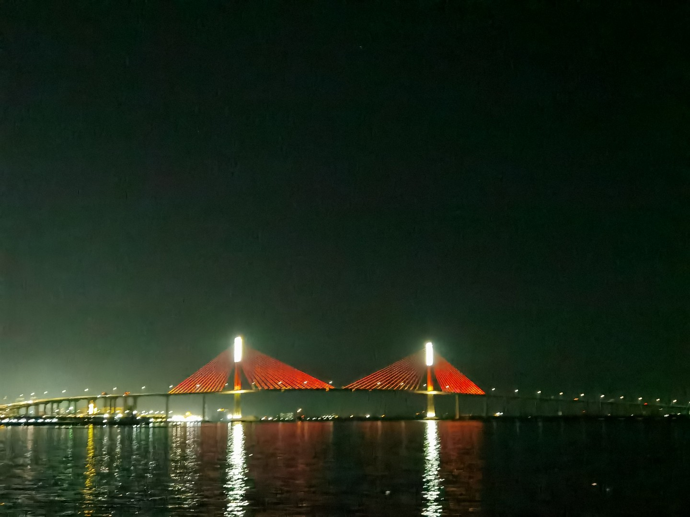

*Living there*

# Life in the Philippines for Indian students

I spent five and a half years in Cebu, and the first one was the hard one. Not the anatomy. The food, the heat, the accent, the silence in a room where nobody knows your name yet. This is the page I wish someone had written for me before I flew.

*Reviewed 25 November 2026. First hand from Cebu, with Manila and Davao checked against students who studied in both.*

*Cebu at night. Small enough to learn in a month, big enough that you keep finding places.*

## The first month is logistics, not medicine

I landed in June, walked out of the airport into air that felt like a wet towel, and spent my first night in a room with a fan that clicked all night. The next two weeks were not about medicine at all. They were a SIM card, a bank account, a medical check for the visa paperwork, a mattress, a bucket, and working out which canteen would not make me ill.

Nobody tells you this part, and it makes the first month feel like a mistake. It is not. It is the same fortnight every international student has, and it passes faster than it feels like it will. By the third week I had a routine, a place to eat, and two people I could text at eleven at night.

If you remember one thing from this page, make it this: the first month is not a test of whether you are cut out for medicine. It is a test of whether you can ask strangers for help. Ask the senior, ask the landlord, ask the security guard. Everyone I asked helped me.

## Food, which is the whole first month

Filipino food is not Indian food, and pretending otherwise is how students end up eating instant noodles for a semester. It is rice-based, often sweet, often pork, and rarely spicy the way you expect. I ate rice and egg for dinner more often in my first year than I will admit to anyone in person.

It is also genuinely good once you stop comparing it to home. Lechon, sinigang, a proper breakfast of garlic rice and dried fish. The trick was to stop looking for dal and start eating what the city eats, then keep Indian food for the days I needed it.

The practical hierarchy: a college mess with Indian cooks is the easiest first year. Manila has enough of an Indian population that spices and restaurants are easy to find. Cebu has Indian restaurants and a few spice shops, but not around every campus. Davao is thinner, and Sasa, where Jose Maria sits, is thinner still.

Where there is no mess, students cook. Before I left home my mother taught me dal, rice and one vegetable, badly, in an afternoon. It was enough. Carry turmeric, cumin, coriander powder, garam masala and chilli powder in checked luggage, because those are the expensive, hard-to-find part. A rice cooker and an induction plate did the rest for five years.

## Rent, by city

I stayed in a hostel for the first year and moved into an apartment with two friends after that. The hostel was plain: bunk bed, shared bathroom, fan, and a curfew I did not love. It was also close to campus, secure, and it meant I did not have to negotiate a lease in a country I had never lived in. For year one, that trade is worth it.

The apartment was cheaper per head and much better for morale. It also taught me that you cannot know who you can live with until you have lived with them, so keep the first lease short and do not sign with someone you met last month.

Manila is the expensive one. Cebu sits in the middle. Davao is the cheapest of the three. Ask students who are there now rather than the admissions office: the office quotes the hostel, and students know what rent actually is.

## Safety, without the hysteria

Five and a half years in Cebu and I never had a serious problem. That is one person's experience, not a guarantee, so here is what people actually mean when they say be careful. All of it is ordinary city sense, and most of it is the same advice your parents gave you about Delhi or Mumbai.

- Do not walk alone at night in an area you do not know yet.
- Do not carry large amounts of cash or wear obvious gold.
- Use Grab rather than unmarked taxis, especially at night and especially in Manila.
- Keep your passport, visa documents and a set of photocopies in different places.
- Learn the local emergency numbers and the college security number in your first week.

Cebu and Davao are calmer than the reputation of Manila suggests. The real risk to your future is not crime. It is drifting for two years and then panicking about FMGE, which has ended more Indian students in the Philippines than anything in the news.

## The accent, and the language

Classes are in English. I understood maybe two thirds of my first lecture and most of the rest by the end of the month. Filipino English runs closer to American English in rhythm than Indian English does, and lecturers switch to Tagalog or Cebuano among themselves, which is not rude, just normal.

Learn a few phrases. "Salamat" for thank you, "magkano" for how much, and a greeting or two. My Cebuano never got past that, and it still changed how people treated me more than any amount of grammar would have.

## Weather, and what it does to your wardrobe

Hot and humid most of the year, with hard rain from roughly June to November. Light cotton clothes, a good umbrella, and shoes that survive a flooded street. I went through three cheap umbrellas before I bought one that cost more and lasted four years.

Air conditioning is standard in classrooms and most hostels, sometimes as a paid extra. A room with air conditioning and a room without are two different rents, and the difference shows up in June.

## Money, month to month

Beyond tuition and rent, my month was food, transport, phone data, and whatever the weekend cost. Cooking cut that down more than anything else I did. Manila costs more than Cebu for the same life, and Davao less.

Open a local bank account in the first month. Carrying cash for a semester is both risky and expensive, and paying tuition through a bank leaves a receipt, which matters if anything is ever disputed. Ask the college which bank they work with for international students, and bring the documents that bank will ask for.

## Homesickness, honestly

The first semester is the hardest and the brochures do not mention it. I missed food, my family, and being understood without effort. Around month three I was fairly sure I had made a mistake. Almost everyone I know went through the same week.

What helped, in order: a routine, three or four people I ate with, one call home at a fixed time each week, and something physical that was not studying. What did not help was going home in the first semester, because I came back and started the whole adjustment again.

By second year Cebu was a place I lived in rather than a place I was stuck in. That happens to most people, and it happens later than you want it to.

## What I would pack again

- Light cotton clothes, a few formal outfits for clinical postings, and a white coat if the college does not issue one.
- Basic spices, sealed properly, in checked luggage.
- Any prescription medicine you take, with the prescription, in its original packaging.
- A universal adapter and a power bank.
- Photocopies of every document, and digital copies in cloud storage.
- One thing that makes the room feel like yours. It matters more than it sounds, and I still have mine.

*Questions*

## The three every parent asks

**Is the Philippines safe for Indian students?**

Cebu, Davao and most student areas of Metro Manila are safe if you use ordinary city sense: do not walk alone in unfamiliar areas at night, do not flash money, and stay in groups when you are new. I lived in Cebu for five and a half years without a serious incident, which is one person's experience and not a guarantee.

**Will I get Indian food?**

In Manila, yes, easily. In Cebu and Davao it depends on the college and the neighbourhood. Where there is no mess, students cook. Learn three dishes before you leave and carry basic spices in your checked luggage. I cooked for five years and it was fine, and cheaper than the alternative.

**What should I pack?**

Light cotton clothes, formal clothes for clinical postings, a white coat if your college does not issue one, basic spices, medicines you trust, and a power adapter. Do not fill a suitcase with winter clothes or gadgets you will not use.

*More guides*

[### City comparison

Which city fits your budget and temperament.](#cities)
[### Fees and costs

What daily life actually costs.](fees-and-cost.html)
[### Six colleges

Where the cities and the colleges meet.](colleges.html)
[### Study resources

The study system for current students.](study-resources.html)
[### Admission process

The steps before you land.](admission-process.html)
[### Questions answered

Safety, food and the first month.](faq.html)

## The comparison table

The college matters more than the city. But the city decides what your ordinary Tuesday feels like, how much you spend outside tuition, and how easily you can get home. This table is the short version. The sections below are the detail.

Cebu, Manila and Davao for an Indian medical student.

| Factor | Cebu | Manila | Davao |
| --- | --- | --- | --- |
| Colleges covered here | GCM Gullas, Southwestern | Perpetual Help (Las Piñas) | DMSF, Brokenshire, Jose Maria |
| Feel | Calmer second city, walkable pockets, island pace | Dense capital, fast, noisy, always open | Smaller southern city, relaxed, spread out |
| Rent and food | Moderate | Highest of the three | Lowest of the three |
| Indian community | Small but present | Largest | Smallest |
| Traffic | Manageable | The main daily tax | Manageable |
| Typhoon exposure | Exposed | Exposed, with flooding | Less exposed than the other two |
| Flights to India | One stop usually, sometimes direct | Most options, one stop or direct | Usually two stops |

## Cebu

Cebu is the second city of the Philippines and the one most Indian students picture when they imagine the country: an island, a busy port, a old Spanish core, and a lot of coastline within an hour of the college. It is smaller than Manila, cheaper, and easier to move around. Mactan airport sits on the island, so the trip home starts close.

Two of the six colleges covered here are in Cebu: [GCM Gullas](colleges.html#gcm-gullas) in Banilad and [Southwestern University](colleges.html#southwestern) in the city. The Indian batch at Gullas is large, and the one at Southwestern is smaller. That difference matters more than the postcode.

The trade is that Cebu is not Manila. There are fewer specialists, fewer big-public-hospital rotations, and a smaller Indian community. If you need a large diaspora to feel settled, Cebu will feel quiet. If you want the city to be the calm part of the decision, it is the easiest of the three.

## Manila

Metro Manila is not one city. It is sixteen, stitched together by highways that are never empty. The college covered here, [University of Perpetual Help](colleges.html#perpetual), is in Las Piñas, south of the old city, which is quieter than the centre but still part of the same sprawl.

The advantage is scale. The largest Indian community of the three, the widest choice of Indian restaurants and grocery shops, the biggest hospitals, and the most flight connections. If you want a city that never makes you feel like the only Indian in the room, Manila is it.

The cost is time and money. Traffic eats an hour or two a day if you live far from campus. Rent is higher. The heat is heavier because the city holds it. And the flooding in the wet season is real, not a joke. Students who thrive here tend to live close to campus and treat the wider city as a weekend place.

## Davao

Davao is on Mindanao, in the south. It is cleaner and calmer than Manila, cheaper than both Manila and Cebu, and spread out enough that you will use transport daily. The three colleges here are [DMSF](colleges.html#dmsf), [Brokenshire](colleges.html#brokenshire) and [Jose Maria](colleges.html#jmc).

DMSF has the strongest clinical reputation of the three, with a large patient load and a 3D anatomy lab. Brokenshire is smaller, with faculty who know your name and a smaller attached hospital. Jose Maria is the budget option, with medical missions and basic facilities. The spread inside one city is wider than the spread between cities.

The trade is distance. Davao is farther from India than Cebu or Manila, and most routes involve two stops. The Indian community is the smallest of the three, and Indian food is harder to find. If you are comfortable cooking and you want the lowest total cost, Davao is worth the trade. If you need frequent flights home, it is not.

## Cost of living

Tuition is set by the college. Living cost is set by the city and by whether you cook. The published 2026-2027 sheets put food and accommodation at 14,000 PHP a month at Gullas and 15,000 PHP a month at DMSF, Jose Maria and Brokenshire. Those are college estimates, not a market survey, and they assume shared accommodation and ordinary meals.

In practice, Manila runs higher than the other two for rent, transport and eating out. Cebu sits in the middle. Davao is the cheapest, but the gap is smaller than the tuition gap between colleges. Do not pick a city to save rent and then pick a college that costs two lakh more.

The bigger variable is food. A student who cooks rice, dal and vegetables most days spends a fraction of what a student spends eating out twice a day. The [cost page](fees-and-cost.html) breaks this into lines you can actually budget.

## Indian food and community

Manila wins on food. Las Piñas and the wider metro have Indian restaurants, spice shops and grocery stores that stock atta, dal, ghee and pickles. Cebu has a smaller but real set of Indian restaurants and spice shops, concentrated in a few areas. Davao has the least; you will cook more, and you will learn to substitute.

The community matters for different reasons. A large Indian batch is company, shared notes, and someone to split rent with. It can also be a bubble that keeps you from learning the local language and making Filipino friends. A small batch is lonelier in the first month and usually forces you into the wider campus. Neither is better. Know which one you are.

## Safety

All three cities are ordinary places to be a student, and none is a war zone. The honest differences are about streets and hours. Manila has parts of the metro where you do not walk alone at night, and pickpocketing is a city problem. Cebu is calmer, with the usual advice about unlit streets and late nights. Davao has a reputation for strict local administration and feels orderly, though the usual precautions still apply.

The bigger safety issue for Indian students is not crime. It is health, heat, and the sea. Learn where the nearest hospital is, keep your embassy contact, save the college's emergency number, and do not swim at beaches with a red flag. The [student life page](student-life.html) goes through the first month.

## Hospitals and clinical exposure

Manila has the largest hospitals and the widest case mix. Cebu has strong regional hospitals and a busy port population. Davao has DMSF's hospital network and Brokenshire's smaller attached hospital. For clinical years, the question is not the city's hospital count but which hospital your college attaches you to, how many students share each bed, and whether foreign students are allowed to examine patients.

Ask that question college by college. A big city with a big hospital is useless if your college sends forty students to one ward and lets them watch. A smaller hospital where you are allowed to clerk, present and assist is better training. The [college comparison](colleges.html) includes hospital exposure for each of the six.

## Weather and typhoons

The Philippines has two seasons: hot and wet, and slightly less hot. The wet season runs roughly June to November, and typhoons are part of life. Manila floods in heavy rain, especially in low-lying districts. Cebu is exposed to storms that cross the Visayas. Davao is farther south and less exposed than the other two, though it still gets heavy rain.

Practical advice: keep a rain jacket, waterproof sandals, and a power bank. Keep copies of your documents in a waterproof bag. Follow PAGASA, the national weather service, rather than a group chat. And do not book a flight home in the middle of a typhoon without a buffer day.

## Flights home

Manila has the most connections to India, usually one stop through Singapore, Kuala Lumpur, Bangkok or the Gulf, and sometimes direct. Cebu is next, with one stop common and direct routes appearing and disappearing by season. Davao usually means two stops, often through Manila, which adds hours and a connection you can miss.

If you plan to go home every year, price the flights before you choose the city. A cheaper college in Davao can lose its advantage over five years if every trip home costs more and takes a day longer. If you plan to stay through the programme, this matters less.

## Which city suits which student

Pick the city that matches the student, not the brochure.

| If you are... | Start with | Because |
| --- | --- | --- |
| On a tight budget | Davao | Lowest living cost, and Jose Maria is the cheapest college of the six |
| Needing a big Indian community | Manila | Most Indian food, shops and students |
| Wanting a calmer city | Cebu | Smaller, cheaper and easier to move around than Manila |
| Planning to fly home every year | Manila or Cebu | Better connections, fewer stops |
| Wanting the strongest clinical volume | Davao (DMSF) | Large patient load and a dedicated anatomy lab |
| Wanting small classes | Davao (Brokenshire) | Smaller batches and more faculty attention |

The final decision is still the college, the fee sheet and the NMC listing. City is the third question, not the first. Read the [college comparison](colleges.html) before you fall in love with a skyline.

*Questions*

## City questions students ask

**Is Manila better than Cebu for Indian students?**

Manila has the largest Indian community, the most food options and the best flight connections. Cebu is calmer, cheaper and easier to get around. Neither is better in general; it depends on whether you want scale or calm.

**Is Davao safe for Indian students?**

Davao is an ordinary student city with a reputation for strict local administration. The usual precautions apply: avoid unlit streets at night, keep your documents safe, and know the nearest hospital. It is not a conflict zone.

**Where is the cheapest place to live?**

Davao is the cheapest of the three for rent and food, followed by Cebu, then Manila. The difference is smaller than the difference between college fee sheets, so do not choose a city to save rent and ignore tuition.

**Which city has the best hospitals for clinical training?**

Manila has the largest hospitals, but what matters is the hospital your college attaches you to and how many students share each ward. Ask that college by college. A smaller hospital with real patient contact beats a large one where you only watch.

**Do I need to speak Tagalog or Cebuano?**

No. Medical teaching is in English and hospital charts are in English. Learning a few phrases in the local language helps with patients and daily life, but it is not required for the course.
