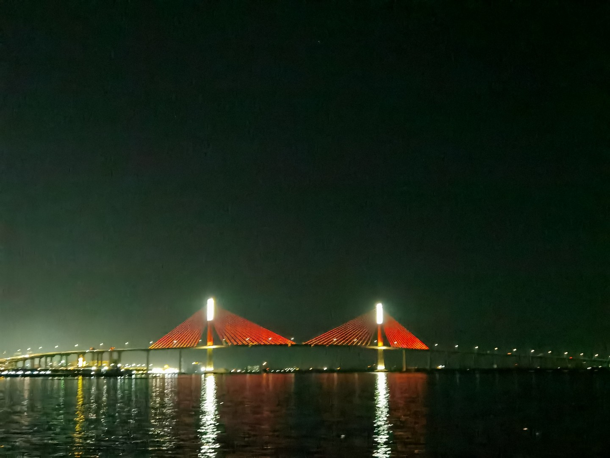

*Living there*

# Student life in the Philippines: food, rent, safety and the first month

The first month is logistics, not medicine. A SIM card, a bank account, a place to sleep and a canteen that agrees with you come before anatomy. This page sets out what daily life costs and feels like in Cebu, Manila and Davao, with current figures and official sources.

*Reviewed 27 November 2026. Ground detail from Cebu, Manila and Davao, with weather data from PAGASA and prices from Numbeo. Figures change, so check the sources before you budget. [CC BY 4.0](https://creativecommons.org/licenses/by/4.0/) — reuse with attribution to drdreams.in.*

**Quick summary.**

The first month in the Philippines is spent on logistics rather than medicine: a SIM card, a bank account, a place to sleep and a canteen that agrees with you. Filipino food is rice-based, often sweet, often pork, and rarely as spicy as Indian food, so a college mess with Indian cooks or a rice cooker and basic spices decides how the first year goes. Room sharing is the normal arrangement: two students in one room pay ₱10,000 to ₱15,000 a month in Manila and ₱8,000 to ₱10,000 in Cebu and Davao, and a hostel with food, electricity, water and cleaning costs ₱13,000 to ₱15,000. Numbeo's perception index puts the Philippines at 43.33 on crime and 56.67 on safety, against India's 44.16 and 55.84. PAGASA defines the rainy season as June to November and notes that typhoons moving north-west spare Mindanao from most direct hits.

*Cebu at night. Small enough to learn in a month, large enough that new places keep turning up.*

## The first month is logistics, not medicine

The arrival month has nothing to do with the course. It is a SIM card, a bank account, a medical check for the visa paperwork, a mattress, a bucket, and working out which canteen will not cause illness. Heat hits first: the air at the airport feels like a wet towel, and a room with a fan that clicks all night is a normal first night.

This fortnight makes many students wonder whether they have made a mistake. That feeling passes faster than it appears to. By the third week there is a routine, a reliable place to eat, and two or three people to message late at night. The whole adjustment rests on one skill: asking strangers for help. Ask the senior student, the landlord and the security guard. They are used to the question.

The first month is not a test of whether you are cut out for medicine. It is a test of whether you can ask for directions, a phone number and a second opinion about a lease.

## Food decides the first year

Filipino food is rice-based, often sweet, often pork, and rarely spicy in the way an Indian student expects. Students who look for dal at every meal end up living on instant noodles. First-year survival frequently comes down to rice and egg. Local staples are good once they are eaten on their own terms: lechon, sinigang, and a breakfast of garlic rice and dried fish.

The practical order is simple. A college mess with Indian cooks is the easiest first year. Manila has enough of an Indian population that spices and restaurants are easy to find. Cebu has Indian restaurants and spice shops in a few areas, but not around every campus. Davao has the least, and Sasa, where Jose Maria sits, has less again.

Where there is no mess, students cook. Learn dal, rice and one vegetable before departure. Carry turmeric, cumin, coriander powder, garam masala and chilli powder in checked luggage, because these are the expensive and hard-to-find part. A rice cooker and an induction plate bought after arrival do the rest. Buying an induction plate is not optional if you plan to cook every day.

Indian food and spices are available around campus in all three cities. The drawback is price: imported groceries cost more than the MRP printed in India because distributors pay import and cargo charges. Budget for that instead of expecting Indian prices.

## Rent and money, month to month

The published 2026 and 2027 college sheets put food and accommodation at 14,000 Philippine pesos a month at Gullas and 15,000 Philippine pesos a month at DMSF, Jose Maria and Brokenshire. Those are college estimates, not a market survey, and they assume shared accommodation and ordinary meals.

Ground reality is room sharing, not one-bedroom listings. Two students in one room pay ₱10,000 to ₱15,000 a month in Manila and ₱8,000 to ₱10,000 in Cebu and Davao. A hostel costs ₱13,000 to ₱15,000 a month with food, electricity, water and cleaning included. Manila feels slightly more expensive than Cebu and Davao because it is a metropolitan area. The difference is modest, and the gap between cities is smaller than the gap between college fee sheets.

An Indian mess subscription outside college costs ₱2,500 a month for one meal a day, or ₱4,500 to ₱5,000 for two meals a day, depending on the restaurant.

A mobile phone plan with at least ten gigabytes of data costs about ₱861 in Manila, ₱907 in Cebu and ₱715 in Davao in the same Numbeo sample. Beyond rent, the monthly spend is food, transport, phone data and whatever the weekend costs. Cooking cuts that figure more than any other single decision.

Open a local bank account in the first month. Carrying cash for a semester is risky and expensive, and paying tuition through a bank leaves a receipt that matters if anything is ever disputed. Ask the college which bank works with international students, and bring the documents that bank requires.

## Safety, with the numbers

Numbeo's November 2026 perception index puts the Philippines at 43.33 on crime and 56.67 on safety, against India at 44.16 on crime and 55.84 on safety. Those are public perception scores, not police records, and they are not a personal guarantee. The useful point is that the Philippines does not rank as a country students should avoid. Ordinary city sense still applies, and most of it is the same advice given to students in Delhi or Mumbai.

- Do not walk alone at night in an area you do not know yet.
- Do not carry large amounts of cash or wear obvious gold.
- Use Grab rather than unmarked taxis, especially at night and especially in Manila.
- Keep your passport, visa documents and a set of photocopies in different places.
- Learn the local emergency numbers and the college security number in the first week.
- Know the nearest hospital, and do not swim at a beach with a red flag.

The larger risk to a medical career is not crime. It is drifting for two years and then panicking about FMGE. That has cost Indian students more time than anything in the news.

## Getting around, and getting things delivered

Ride-hailing and food delivery work from a phone, the same way Rapido, Swiggy and Zomato work in India. Grab offers four-seater and six-seater GrabCar rides, advance booking for airport trips and upfront pricing, and its GrabFood service delivers meals. Foodpanda is the other main food delivery app. Angkas, MoveIt and Joyride are the motorcycle taxis for short trips; Joyride also carries courier and freight work.

The official sites are [Grab](https://www.grab.com/ph/), [Angkas](https://angkas.com/), [MoveIt](https://moveit.ph/), [Joyride](https://joyride.ph/) and [foodpanda](https://www.foodpanda.ph/).

Jeepneys are the cheapest way to move inside a city. Note the number painted on the jeepney: it marks the route and the stops, so you can work out which one goes your way. For long-distance trips, go to the bus terminal, or book a self-drive car or a car with a driver through Facebook Marketplace, where prices are often the lowest. The same marketplace is active for house listings and second-hand goods.

## Shopping, groceries and local markets

[Shopee](https://shopee.ph/), [Lazada](https://www.lazada.ph/), [Shein](https://ph.shein.com/) and [Temu](https://www.temu.com/ph-en/) are the online shopping sites that work like Flipkart in India. They are usually cheaper than buying in a shop. Delivery takes about four to five days in Metro Manila and seven to eight days in Cebu and Davao. [Facebook Marketplace](https://www.facebook.com/marketplace/) covers cars, rooms, second-hand goods and house listings.

For everyday groceries, the malls and Gaisano stores are cheaper than a convenience shop. Local markets are cheaper again:

- **Cebu:** Carbon Market in downtown Cebu, the largest market in the city and the oldest in Central Visayas, with dry goods, fruit, vegetables and meat. Colon Street nearby is the old shopping street.
- **Manila:** Divisoria in Tondo, Binondo and San Nicolas for low-priced goods, with Tutuban Center and a night market. Quinta Market on Carlos Palanca Street in Quiapo sits beside the Pasig River.
- **Davao:** Bankerohan Public Market, the largest and busiest market in the city, for wet and dry goods.

Map links: [Carbon Market, Cebu](https://www.google.com/maps/search/Carbon+Market+Cebu), [Divisoria, Manila](https://www.google.com/maps/search/Divisoria+Manila), [Quinta Market, Manila](https://www.google.com/maps/search/Quinta+Market+Quiapo+Manila), [Bankerohan Public Market, Davao](https://www.google.com/maps/search/Bankerohan+Public+Market+Davao), and [Gaisano stores](https://en.wikipedia.org/wiki/Gaisano_Malls).

## The language

Classes are in English and hospital records are in English. Filipino English follows an American rhythm rather than an Indian one, so the first lecture takes effort. Lecturers switch to Tagalog or Cebuano among themselves. That is normal conversation, not rudeness aimed at foreign students.

Learn a few phrases: salamat for thank you, magkano for how much, and one greeting in the local language. The effort changes how people respond to you more than any amount of grammar.

## Weather, and what it does to a wardrobe

PAGASA, the national weather service, defines two major seasons using temperature and rainfall. The rainy season runs from June to November. The dry season runs from December to May, split into a cool dry season from December to February and a hot dry season from March to May. National annual rainfall ranges from 965 to 4,064 millimeters. General Santos City in Cotabato, near Davao, averages only 978 millimeters a year.

PAGASA also notes that typhoons generally form near the Marianas and Caroline Islands and track north-west, which spares Mindanao from most direct hits. That is the official reason Davao is less exposed than Luzon and the Visayas. It still rains hard there.

Carry light cotton clothes and one sturdy umbrella. Cheap umbrellas break in monsoon wind and need replacing every few weeks; a better one lasts years. Shoes must survive a flooded street. Air conditioning is standard in classrooms and common in hostels, sometimes as a paid extra. A room with air conditioning and a room without are two different rents, and the difference is most obvious in June. Keep documents in a waterproof bag, follow PAGASA rather than a group chat during a storm, and leave a buffer day around any flight in the wet season.

## Homesickness, stated plainly

The first semester is the hardest part of the programme and the brochures do not mention it. Students miss food, family and being understood without effort. Around the third month many are sure they have made a mistake. That week is common, and it ends.

What helps, in order: a routine, three or four people you eat with, one call home at a fixed time each week, and something physical that is not studying. Going home in the first semester does not help, because the adjustment starts again on return. By the second year the city stops feeling temporary for most students. It happens later than anyone wants.

## What to pack

- Light cotton clothes, a few formal outfits for clinical postings, and a white coat if the college does not issue one.
- Basic spices in sealed packets, in checked luggage.
- Prescription medicine in its original packaging, with the prescription.
- A universal adapter and a power bank.
- Paper copies of every document, and digital copies in cloud storage.
- One item that makes the room feel like your own. It matters more than it sounds.

Leave winter clothes and unused gadgets at home. The heat does not let up enough to justify the weight.

*More guides*

[Life outside studies — Food, weekends and travel beyond campus.](../life-outside-studies/)
[Fees and costs — What daily life actually costs.](../fees-and-cost/)
[Six colleges — Where the cities and the colleges meet.](../colleges/)
[Study resources — The study system for current students.](../study-resources/)
[Admission process — The steps before you land.](../admission-process/)
[Questions answered — Safety, food and the first month.](../faq/)

## The comparison table

The college matters more than the city. The city decides what an ordinary Tuesday feels like, how much you spend outside tuition, and how easily you can get home. This is the short version. The sections below carry the detail.

Cebu, Manila and Davao for an Indian medical student.

| Factor | Cebu | Manila | Davao |
| --- | --- | --- | --- |
| Colleges covered here | GCM Gullas, Southwestern | Perpetual Help (Las Piñas) | DMSF, Brokenshire, Jose Maria |
| Feel | Calmer second city, walkable pockets, island pace | Dense capital, fast, noisy, always open | Smaller southern city, relaxed, spread out |
| Shared room | ₱8,000 to ₱10,000 | ₱10,000 to ₱15,000 | ₱8,000 to ₱10,000 |
| Indian community | Small but present | Largest | Smallest |
| Traffic | Manageable | The main daily tax | Manageable |
| Typhoon exposure | Exposed | Exposed, with flooding | Less exposed than the other two |
| Flights to India | One stop usually, sometimes direct | Most options, one stop or direct | Usually two stops |

## Cebu

Cebu is the second city of the Philippines: an island, a busy port, an old Spanish core and a great deal of coastline within an hour of the colleges. It is smaller than Manila, cheaper in the city centre and easier to move around. Mactan airport sits on the island, so the trip home starts close.

Two of the six colleges covered here are in Cebu: [GCM Gullas](../colleges/#gcm-gullas) in Banilad and [Southwestern University](../colleges/#southwestern) in the city. The Indian batch at Gullas is large and the one at Southwestern is smaller. That difference matters more than the postcode.

The trade is that Cebu is not Manila. There are fewer specialists, fewer large public hospital rotations and a smaller Indian community. A student who needs a large diaspora will find Cebu quiet. A student who wants the city to be the calm part of the decision will find it the easiest of the three.

## Manila

Metro Manila is not one city. It is sixteen cities and one municipality, stitched together by highways that are never empty. The college covered here, [University of Perpetual Help](../colleges/#perpetual), is in Las Piñas, south of the old city, which is quieter than the centre but still part of the same sprawl.

The advantage is scale. The largest Indian community of the three, the widest choice of Indian restaurants and grocery shops, the largest hospitals and the most flight connections. A student who does not want to be the only Indian in the room will find Manila comfortable.

The cost is time and money. Traffic takes an hour or two a day if you live far from campus. Rent is highest in the city centre. The heat is heavier because the city holds it, and flooding in the wet season is real. Students who manage well live close to campus and treat the wider city as a weekend place.

## Davao

Davao is on Mindanao, in the south. It is cleaner and calmer than Manila, cheaper than both Manila and Cebu, and spread out enough that you will use transport daily. The three colleges here are [DMSF](../colleges/#dmsf), [Brokenshire](../colleges/#brokenshire) and [Jose Maria](../colleges/#jmc).

DMSF has the strongest clinical reputation of the three, with a large patient load and a three-dimensional anatomy laboratory. Brokenshire is smaller, with faculty who know your name and a smaller attached hospital. Jose Maria is the budget option, with medical missions and basic facilities. The spread inside one city is wider than the spread between cities.

The trade is distance. Davao is farther from India than Cebu or Manila, and most routes involve two stops. The Indian community is the smallest of the three and Indian food is harder to find. A student who cooks and wants the lowest total cost will find Davao worth the trade. A student who needs frequent flights home will not.

## Cost of living

Tuition is set by the college. Living cost is set by the city and by whether you cook. The college estimates of 14,000 Philippine pesos a month at Gullas and 15,000 Philippine pesos a month at DMSF, Jose Maria and Brokenshire assume shared accommodation and ordinary meals. Ground figures for a shared room are ₱10,000 to ₱15,000 in Manila and ₱8,000 to ₱10,000 in Cebu and Davao, with hostels at ₱13,000 to ₱15,000 including food and utilities.

Manila costs slightly more than Cebu and Davao because it is a metropolitan area. A shared room there is ₱10,000 to ₱15,000, against ₱8,000 to ₱10,000 in the other two. None of these gaps is as large as the difference between two college fee sheets, so do not pick a city to save rent and then pick a college that costs two lakh more.

The larger variable is food. A student who cooks rice, dal and vegetables most days spends a fraction of what a student spends eating out twice a day. The [cost page](../fees-and-cost/) breaks this into lines you can budget.

## Indian food and community

Manila wins on food. Las Piñas and the wider metro have Indian restaurants, spice shops and grocery stores stocking atta, dal, ghee and pickles. Cebu has a smaller but real set of Indian restaurants and spice shops, concentrated in a few areas. Davao has the least, so students cook more and learn to substitute.

Community matters for different reasons. A large Indian batch means company, shared notes and someone to split rent with. It can also become a bubble that keeps you from learning the local language and making Filipino friends. A small batch is lonelier in the first month and usually pushes students into the wider campus. Neither is better. Know which one suits you.

## Safety

All three cities are ordinary places to be a student. The honest differences are about streets and hours. Manila has parts of the metro where you do not walk alone at night, and pickpocketing is a city problem. Cebu is calmer, with the usual advice about unlit streets and late nights. Davao has a reputation for strict local administration and feels orderly, though the usual precautions still apply.

The wider safety issue for Indian students is health, heat and the sea. PAGASA's climate page gives the official weather picture, and the Numbeo index gives the safety comparison. Keep the embassy contact and the college emergency number saved, and do not treat either index as a promise about your own street.

## Hospitals and clinical exposure

Manila has the largest hospitals and the widest case mix. Cebu has strong regional hospitals and a busy port population. Davao has DMSF's hospital network and Brokenshire's smaller attached hospital. For clinical years the question is not the city's hospital count but which hospital your college attaches you to, how many students share each bed and whether foreign students are allowed to examine patients.

Ask that question college by college. A large city with a large hospital is useless if your college sends forty students to one ward and lets them watch. A smaller hospital where students clerk, present and assist is better training. The [college comparison](../colleges/) records hospital exposure for each of the six.

## Weather and typhoons

PAGASA puts the rainy season at June to November and the dry season at December to May, with a cool dry period from December to February and a hot dry period from March to May. Manila floods in heavy rain, especially in low-lying districts. Cebu is exposed to storms crossing the Visayas. Davao is farther south, and PAGASA notes that north-west-tracking typhoons spare Mindanao from most direct hits, although it still gets heavy rain.

Practical advice: keep a rain jacket, waterproof sandals and a power bank. Keep document copies in a waterproof bag. Follow PAGASA rather than a group chat. Do not book a flight home in the middle of a typhoon without a buffer day.

## Flights home

Manila has the most connections to India, usually one stop through Singapore, Kuala Lumpur, Bangkok or the Gulf, and sometimes direct. Cebu is next, with one stop common and direct routes appearing and disappearing by season. Davao usually means two stops, often through Manila, which adds hours and a connection you can miss.

If you plan to go home every year, price the flights before you choose the city. A cheaper college in Davao can lose its advantage over five years if every trip home costs more and takes a day longer. If you plan to stay through the programme, this matters less.

## Which city suits which student

Pick the city that matches the student, not the brochure.

| If you are... | Start with | Because |
| --- | --- | --- |
| On a tight budget | Davao | Lowest living cost, and Jose Maria is the cheapest college of the six |
| Needing a large Indian community | Manila | Most Indian food, shops and students |
| Wanting a calmer city | Cebu | Smaller, cheaper in the centre, and easier to move around than Manila |
| Planning to fly home every year | Manila or Cebu | Better connections, fewer stops |
| Wanting the strongest clinical volume | Davao (DMSF) | Large patient load and a dedicated anatomy laboratory |
| Wanting small classes | Davao (Brokenshire) | Smaller batches and more faculty attention |

The final decision is still the college, the fee sheet and the NMC requirements. City is the third question, not the first. Read the [college comparison](../colleges/) before you decide on a skyline.

*Check the source*

## Where the figures come from

Prices, weather and safety scores change. These are the sources used on this page, checked on 27 November 2026. Open them before you commit money to a city.

- [PAGASA: Climate of the Philippines](https://www.pagasa.dost.gov.ph/information/climate-philippines)
- [Numbeo: crime index, Philippines](https://www.numbeo.com/crime/country_result.jsp?country=Philippines)
- [Numbeo: crime index, India](https://www.numbeo.com/crime/country_result.jsp?country=India)
- [Grab](https://www.grab.com/ph/)
- [Angkas](https://angkas.com/)
- [MoveIt](https://moveit.ph/)
- [Joyride](https://joyride.ph/)
- [foodpanda](https://www.foodpanda.ph/)
- [Shopee](https://shopee.ph/)
- [Lazada](https://www.lazada.ph/)
- [Shein](https://ph.shein.com/)
- [Temu](https://www.temu.com/ph-en/)
- [Facebook Marketplace](https://www.facebook.com/marketplace/)

*Questions*

## What students and parents ask

**Is the Philippines safe for Indian students?**

Numbeo's November 2026 perception index puts the Philippines at 43.33 on crime and 56.67 on safety, against India at 44.16 and 55.84. That is public perception, not police data, and it is not a personal guarantee. Use ordinary city sense: do not walk alone in unfamiliar areas at night, do not flash money, and use ride-hailing rather than unmarked taxis.

**Will I get Indian food?**

In Manila, yes, easily. Cebu has Indian restaurants and spice shops in a few areas. Davao has the least, and students cook more. A college mess with Indian cooks is the easiest first year. Carry turmeric, cumin, coriander powder, garam masala and chilli powder in checked luggage, and buy a rice cooker and an induction plate on arrival.

**What should I pack for the Philippines?**

Light cotton clothes, formal clothes for clinical postings, a white coat if the college does not issue one, basic spices in sealed packets, prescription medicine in its original packaging with the prescription, a universal adapter, a power bank, and copies of every document in both paper and cloud form. Leave winter clothes at home.

**Is Manila better than Cebu for Indian students?**

Neither is better in general. Manila has the largest Indian community, the widest choice of Indian groceries and restaurants, the largest hospitals and the most flight connections. Cebu is calmer, more compact and easier to move around. A shared room costs ₱10,000 to ₱15,000 a month in Manila and ₱8,000 to ₱10,000 in Cebu. Choose on the college first, then the city.

**Is Davao safe for Indian students?**

Davao is an ordinary student city with a reputation for strict local administration. PAGASA notes that typhoons moving north-west from the Pacific spare Mindanao from most direct hits, so storm exposure is lower than in Luzon and the Visayas. The usual city precautions still apply: avoid unlit streets at night, keep documents safe, and know the nearest hospital.

**Where is the cheapest place to live?**

Cebu and Davao are the cheapest of the three: a shared room costs ₱8,000 to ₱10,000 a month, against ₱10,000 to ₱15,000 in Manila. A hostel with food and utilities costs ₱13,000 to ₱15,000. The difference between cities is smaller than the difference between college fee sheets.

**Which city has the best hospitals for clinical training?**

Manila has the largest hospitals and the widest case mix, but the hospital your college attaches you to matters more. Ask how many students share each ward and whether foreign students examine patients. A smaller hospital with real patient contact is better training than a large one where students only watch.

**Do I need to speak Tagalog or Cebuano?**

No. Medical teaching and hospital records are in English. Lecturers switch between English, Tagalog and Cebuano among themselves, which is normal and not directed at foreign students. A few phrases help with patients and vendors: salamat for thank you, magkano for how much, and one greeting.
